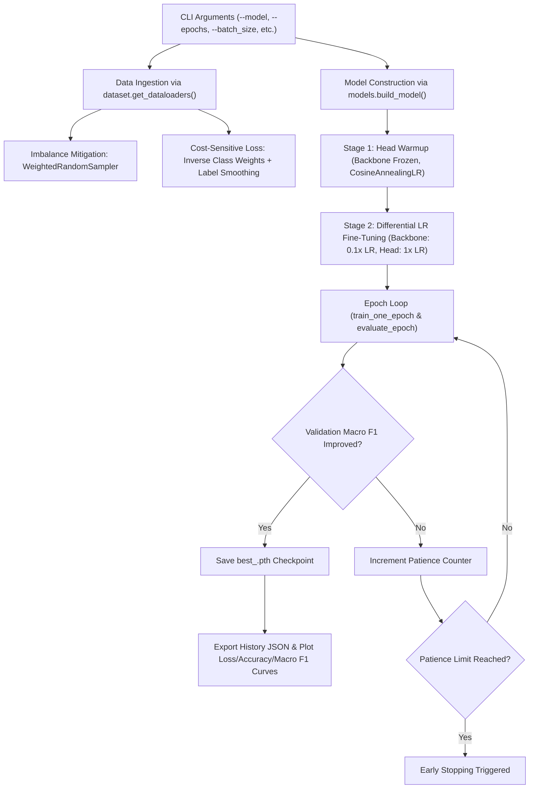

# Code Architecture & Workflow Explanation: `train.py`

**File:** [`train.py`](file:///c:/Github/BTP/Multi-Class-Coconut-Tree-Disease-Detection-and-Classification/train.py)  
**Project:** Multi-Class Coconut Tree Disease Detection and Classification  
**Target:** Standardized, Imbalance-Resilient Deep Learning Training Pipeline  

---

## 1. Executive Summary & Purpose

[`train.py`](file:///c:/Github/BTP/Multi-Class-Coconut-Tree-Disease-Detection-and-Classification/train.py) serves as the **core training engine** for the coconut tree disease detection system. It automates model training, validation, transfer learning, regularization, imbalance mitigation, and model checkpointing across multiple Convolutional Neural Network (CNN) architectures.

### Primary Challenges Addressed:
1. **Severe Class Imbalance (~4.5 : 1 ratio):** In standard cross-entropy training, dominant classes (*Gray Leaf Spot* with 2,135 images and *Leaf Rot* with 1,673 images) dominate gradients, starving minority classes (*Bud Rot* with 470 images and *Bud Root Dropping* with 514 images). `train.py` implements a triple-layer defense: balanced mini-batch sampling, inverse-frequency loss weighting, and checkpointing strictly on Macro F1.
2. **Transfer Learning Stability:** Fine-tuning pre-trained ImageNet backbones on small or specialized domain datasets often distorts pre-trained feature extractors. `train.py` implements a **Two-Stage Fine-Tuning** strategy with classification head warmup and differential learning rates.
3. **Overconfidence & Generalization:** Integrates **Label Smoothing** ($0.1$) and **Cosine Annealing Learning Rate scheduling** with **Early Stopping**.

---

## 2. High-Level Pipeline Architecture



---

## 3. Modular Dependencies

[`train.py`](file:///c:/Github/BTP/Multi-Class-Coconut-Tree-Disease-Detection-and-Classification/train.py) integrates cleanly with the other project modules:

| Imported Module | Role in Training Pipeline |
| :--- | :--- |
| [`config.py`](file:///c:/Github/BTP/Multi-Class-Coconut-Tree-Disease-Detection-and-Classification/config.py) | Central source of truth: hyperparameters (`BATCH_SIZE=32`, `IMAGE_SIZE=(256, 256)`, `LEARNING_RATE=1e-4`), file system paths (`OUTPUT_DIR`, `CHECKPOINT_DIR`, `METRICS_DIR`, `PLOTS_DIR`), and hardware device (`cuda` or `cpu`). |
| [`dataset.py`](file:///c:/Github/BTP/Multi-Class-Coconut-Tree-Disease-Detection-and-Classification/dataset.py) | Loads stratified Train/Val/Test CSV splits, attaches data augmentation pipelines (`get_transforms`), and configures `WeightedRandomSampler`. |
| [`loss.py`](file:///c:/Github/BTP/Multi-Class-Coconut-Tree-Disease-Detection-and-Classification/loss.py) | Calculates class penalty weights (`compute_class_weights`) and instantiates `weighted_ce` or `focal` loss criteria with label smoothing. |
| [`metrics.py`](file:///c:/Github/BTP/Multi-Class-Coconut-Tree-Disease-Detection-and-Classification/metrics.py) | Computes multi-class evaluation metrics: Overall Accuracy, Macro/Weighted Precision, Recall, and Macro F1-Score. |
| [`models.py`](file:///c:/Github/BTP/Multi-Class-Coconut-Tree-Disease-Detection-and-Classification/models.py) | Model factory (`build_model`) instantiating MobileNetV2, ResNet50, EfficientNet-B0, DenseNet121, or VGG16 with custom 5-class heads and dropout. |

---

## 4. Deep-Dive: Key Code Functions & Components

### 4.1. `train_one_epoch(...)` (Lines 36–66)

```python
def train_one_epoch(model, dataloader, criterion, optimizer, device):
```
- **State Transition:** Calls `model.train()` to activate dropout layers and enable batch normalization running statistics updates.
- **Batch Processing Loop:**
  1. Loads mini-batches of `(images, targets)` and transfers them to the target execution `device` (NVIDIA CUDA GPU if present).
  2. Clears stale gradients via `optimizer.zero_grad()`.
  3. Executes the forward pass: `outputs = model(images)`.
  4. Evaluates loss with label smoothing and class penalty weights: `batch_loss = criterion(outputs, targets)`.
  5. Executes backpropagation: `batch_loss.backward()`.
  6. Updates model weights: `optimizer.step()`.
- **Metric Aggregation:** Converts predictions (`torch.argmax(outputs, dim=1)`) and targets into NumPy arrays and calls [`metrics.compute_metrics`](file:///c:/Github/BTP/Multi-Class-Coconut-Tree-Disease-Detection-and-Classification/metrics.py) to return epoch loss and macro-averaged metrics.
- **Progress Visualization:** Wrapped in `tqdm` for interactive command-line progress monitoring with fallback if `tqdm` is unavailable.

---

### 4.2. `evaluate_epoch(...)` (Lines 69–96)

```python
@torch.no_grad()
def evaluate_epoch(model, dataloader, criterion, device):
```
- **Inference Optimization:** Decorated with `@torch.no_grad()` to disable PyTorch's dynamic computational graph generation, cutting GPU memory consumption in half and accelerating evaluation.
- **Deterministic Evaluation:** Invokes `model.eval()`, which switches dropout layers to pass-through mode and fixes batch normalization running statistics.
- **Outputs:** Returns the average validation loss and a dictionary of multi-class metrics identical to the training epoch for direct side-by-side comparison.

---

### 4.3. `plot_training_curves(...)` (Lines 99–136)

```python
def plot_training_curves(history: dict, save_path: Path):
```
Automatically generates a high-resolution (300 DPI), 3-panel figure comparing Training vs. Validation progress across epochs:
1. **Loss Panel:** Cross-Entropy / Focal loss convergence.
2. **Accuracy Panel:** Overall categorical accuracy percentage.
3. **Macro F1-Score Panel:** Unweighted average of per-class F1-scores. This is the **primary diagnostic curve** to ensure the model does not sacrifice minority disease accuracy.
Saved to: `outputs/plots/curves_<model>.png`.

---

### 4.4. The Main Engine: `run_training(...)` (Lines 140–326)

This function coordinates the complete training lifecycle:

#### Step 1: DataLoaders & Imbalance Profiling (Lines 167–177)
```python
train_loader, val_loader, test_loader, train_counts = dataset.get_dataloaders(
    batch_size=batch_size,
    use_balanced_sampler=use_balanced_sampler,
    force_resplit=force_resplit,
    max_samples_per_class=samples_per_class,
)
```
- If `force_resplit=True` (triggered via `--resplit`), regenerates the 70/15/15 stratified train/val/test splits.
- If `use_balanced_sampler=True`, constructs a `WeightedRandomSampler` such that each mini-batch draws minority examples with equal probability.

#### Step 2: Loss Function with Class Weighting & Label Smoothing (Lines 178–189)
```python
class_weights = loss.compute_class_weights(train_counts, method="inverse_freq")
criterion = loss.get_loss_function(
    loss_type,
    class_weights=class_weights,
    device=config.DEVICE,
    label_smoothing=label_smoothing,
)
```
- Computes penalty weights $w_c = \frac{N}{C \cdot N_c}$ so errors on rare diseases (*Bud Rot*) receive higher gradient penalties.
- Applies `label_smoothing=0.1`, which replaces one-hot target vectors with $(1 - \epsilon)$ on the correct class and $\frac{\epsilon}{K-1}$ across other classes, discouraging over-confident memorization.

#### Step 3: Model Architecture Setup (Lines 190–202)
- Builds the selected backbone (`mobilenet_v2`, `resnet50`, etc.) initialized with ImageNet pre-trained weights.
- Replaces the top layer with a customized 5-class head and optional dropout.

#### Step 4: Two-Stage Fine-Tuning & Differential Learning Rates (Lines 203–226 & 241–265)
- **Stage 1 (Head Warmup for `warmup_epochs`, default: 3):**
  - Convolutional backbone layers (`features` or convolutional blocks) are frozen (`requires_grad = False`).
  - Only the new classification head is optimized using `AdamW` and `CosineAnnealingLR` (down to $1\times 10^{-5}$).
  - Prevents random initial gradients of the new head from destroying pre-trained feature weights.
- **Stage 2 (Differential Learning Rates Fine-Tuning):**
  - At `epoch == warmup_epochs + 1`, the entire model is unfrozen (`requires_grad = True`).
  - Parameter groups are created:
    - **Backbone LR:** $0.1 \times \text{Base LR}$ (e.g., $1\times 10^{-5}$) for gentle feature adaptation.
    - **Head LR:** $1.0 \times \text{Base LR}$ (e.g., $1\times 10^{-4}$) for disease task convergence.
  - Scheduler restarts with Cosine Annealing over remaining epochs.

#### Step 5: Checkpointing Strictly on Macro F1 (Lines 285–305)
```python
improved = False
if val_met["macro_f1"] > best_val_macro_f1:
    improved = True
elif val_met["macro_f1"] == best_val_macro_f1 and val_loss < best_val_loss:
    improved = True
```
> [!IMPORTANT]
> **Why Macro F1 instead of Accuracy?**  
> If a model predicts the majority class (*Gray Leaf Spot*) correctly for all images but misses every case of *Bud Rot*, its raw accuracy would still be ~75%–80%. Macro F1 gives equal 20% weight to every class regardless of image count, guaranteeing that a checkpoint is saved only when minority disease detection actually improves.

Checkpoints are saved to `outputs/checkpoints/best_<model>.pth` containing:
- `epoch`: Best epoch number
- `model_name`: Architecture string
- `model_state_dict`: Saved PyTorch weights
- `optimizer_state_dict`: Optimizer momentum/states
- `best_val_macro_f1`: Macro F1 achieved
- `val_accuracy`: Categorical accuracy achieved
- `class_names`: List of class names

#### Step 6: Early Stopping (Lines 306–312)
- Monitors validation Macro F1 across epochs.
- If no improvement occurs for `patience` consecutive epochs (default: 7), training halts early to prevent overfitting.

---

## 5. Command-Line Interface (CLI) Reference

The script can be executed with granular control over all hyperparameters:

```powershell
python train.py [OPTIONS]
```

| Flag | Type | Default | Description |
| :--- | :---: | :---: | :--- |
| `--model` | `str` | `mobilenet_v2` | Backbone architecture: `mobilenet_v2`, `resnet50`, `efficientnet_b0`, `densenet121`, `vgg16`. |
| `--loss` | `str` | `weighted_ce` | Loss criterion: `standard_ce`, `weighted_ce`, or `focal`. |
| `--epochs` | `int` | `25` | Total number of training epochs. |
| `--batch_size` | `int` | `32` | Mini-batch size. |
| `--lr` | `float` | `1e-4` | Base learning rate for AdamW optimizer. |
| `--weight_decay` | `float` | `1e-4` | L2 weight decay regularization. |
| `--dropout` | `float` | `None` | Dropout probability in the classification head (e.g., `0.3`, `0.5`). |
| `--freeze_backbone` | `flag` | `False` | When passed, permanently freezes the backbone (trains head only). |
| `--patience` | `int` | `7` | Early stopping tolerance (epochs without Macro F1 gain). `0` disables. |
| `--no_sampler` | `flag` | `False` | Disables `WeightedRandomSampler` (uses standard uniform shuffling). |
| `--resplit` | `flag` | `False` | Forces recalculation of stratified train/val/test splits from raw data. |
| `--samples_per_class`| `int` | `None` | Caps each class to $N$ images (e.g. `470` for balanced undersampling). |
| `--warmup_epochs` | `int` | `3` | Number of epochs for Stage 1 head warmup before unfreezing backbone. |
| `--label_smoothing` | `float` | `0.1` | Softens target class distributions to improve generalization. |

---

## 6. Generated Output Artifacts

Running `train.py` produces three tangible artifacts per model:

```
outputs/
├── checkpoints/
│   └── best_<model>.pth        # PyTorch binary weights corresponding to peak Val Macro F1
├── metrics/
│   └── history_<model>.json    # Per-epoch numerical log of train/val loss, acc, and macro-F1
└── plots/
    └── curves_<model>.png      # 300 DPI visualization of learning curves
```
